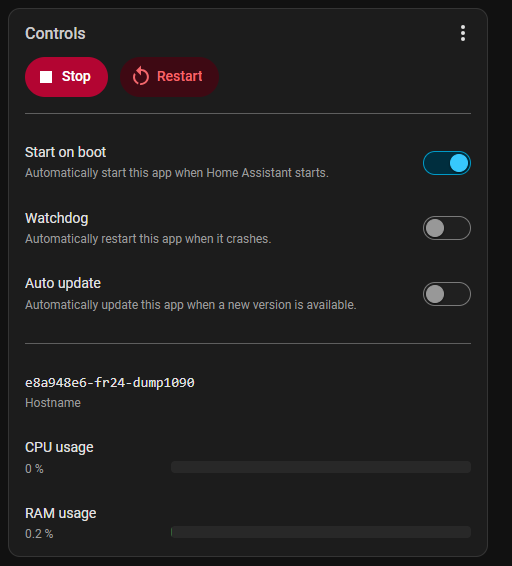

# FR24 dump1090 Bridge

## v0.7.0-dev.13 — Live map theme selector

Choose **Auto / Light / Dark** from **Map theme** in the map toolbar. The palette changes immediately without an App restart, page reload or density query. Auto continues to follow browser/device preference. Your choice remains active for that open map page, including periodic configuration refreshes. The App's saved `map_theme` setting is the default when opening/reloading a map page; it remains covered by settings backup/recovery.

## v0.7.0-dev.12 — Selectable map theme

Set `map_theme` to `auto` (default), `light`, or `dark` in App Configuration. Save and restart the App, then reload the map. Auto follows the browser/device color preference and responds when it changes; it does not read Home Assistant's separately selected frontend theme. Light and dark explicitly choose the basemap palette. Motion/aircraft, density, range and envelope colors remain unchanged. The setting is included in persistent settings backup/recovery; older configurations and snapshots default to auto.

## v0.7.0-dev.11 — SFDPS reported speed and modeled arrival preview

SFDPS speed primitives now use fresh **reported ground speed**. Position-derived speed remains visible in diagnostics and is the fallback when reported speed is missing/stale. Course/turns still use observed positions; altitude trends still use observed altitude. Each speed-dependent result records its basis, and the SFDPS popup shows **Motion speed source**. Speed-basis switches close previous speed events rather than merging unlike series. SBS/aircraft.json retain their existing position-derived detection. TFMS remains excluded from motion.

The existing **ETA · current ground speed** stays as a baseline and is now available on SFDPS local views. A separate **Estimated arrival · modeled** range is available for recognizable transport jets with fresh supported inbound motion, fresh reported ground speed, observed altitude provenance, and known airport elevation. It integrates descent and linear slowdown together; it does not add an entire descent duration to overlapping travel time. Expand Arrival assumptions for the two experimental profiles. They are assumed ground-speed scenarios, not indicated-airspeed rules or validated landing forecasts. Unknown types, stale/missing inputs, climbing/turning/outbound aircraft fall back with an explicit reason; short-distance/high-altitude cases report that extra route distance would be needed rather than force an impossible direct scenario.

Airport data now includes validated elevation and airport type from the October 12 pinned public-domain/PDDL snapshot. FAA data outputs remain disabled; arrival estimates are local map presentation only. See `docs/v0.7.0-dev.11-testing.md` and `docs/motion-analytics-engineering.md` for source selection, equations, profiles and limitations.

## v0.7.0-dev.10 — Automatic cached views and speed diagnostics

After pan/zoom or altitude changes, a fully cached, fresh density view loads automatically once movement settles. Missing or stale tiles keep **Load density needed** and require a manual load. Automatic requests are cache-only: an expiry or clear between the inventory check and load returns a pending view without starting SQL/rebuild work. **Refresh now** still explicitly forces rebuilding. Density loading on enable is unchanged.

With `verbose_logging` enabled, expand **Speed diagnostics** in an aircraft popup to see position-derived ground speed, reported speed, the latest-leg versus latest-report difference, derived speed min/median/max, range, fit residual, trend, accepted position intervals, and the exact stable-speed blockers. Verbose Motion diagnostics now summarize these values across fresh tracks without recording aircraft identifiers or positions. SBS/aircraft.json reported speed is labeled reported ground speed; SFDPS remains **reported speed (meaning unverified)**. Missing/stale reported fields are omitted from comparisons; unknown field timing is labeled snapshot assumption. These are diagnostic comparisons, not validation that the reported field and derived leg measure the same interval or speed quantity.

Detection thresholds, motion labels, SFDPS local-view isolation and source exclusions are unchanged. See `docs/v0.7.0-dev.10-testing.md` and the motion engineering notes. Repeated geometry remains the next increment, v0.7.1-dev.1.

## v0.7.0-dev.9 — Compact density status and SFDPS analytics

Enabling **Traffic Density** loads the selected view automatically. The compact summary shows the window, altitude selection, displayed cell count, oldest tile generation time, and **cached / to build / stale** tile counts. These counts describe the current requested viewport, not the previous request's hits/misses. Pan, zoom or change bands, then use **Load density**; **Refresh now** forces recomputation. The previous layer remains visible until the next load. When the view changes, its cell count/time still describe that displayed layer and the banner marks **Load density needed**. Cache inventory is checked without querying observations or building grids; stale tiles are checked once per minute while density is enabled. Grid resolution, timing and SQL details remain in `/traffic-density/status` and diagnostic logs.

SFDPS now collects source-separated density and supports local motion colors, filters and popup primitives. Density credits eligible reported-position cells in each Bridge publication snapshot, including repeated retained positions; it does not count only distinct FAA reports or fill paths between reports. Motion instead deduplicates actual SFDPS position timestamps and derives ground speed/course from independent positions. Its preview profile uses a 120-second window, at least five samples spanning 60 seconds, and a 45-second gap/freshness limit. Reported altitude retains the label `sfdps_reported_altitude`; its datum is not assumed to be ADS-B barometric altitude. These thresholds require validation against the user's authorized feed.

SFDPS range-bearing collection and density-derived envelopes remain disabled. FAA aircraft, density and per-track motion outputs remain unavailable as general feed/export APIs; SFDPS motion and density are rendered through the local viewer. Safe aggregate status and cache-inventory counters remain available. TFMS remains excluded from motion analytics; coarse `flights.js` positions remain excluded too. Existing source histories are preserved.

## Earlier preview: v0.7.0-dev.4 — SFDPS local view and larger aircraft

Aircraft markers are now 36 × 36 px (1.5×), with centered anchors. Select `swim_sfdps` to view authorized FAA SFDPS FIXM surveillance tracks using the existing SWIM connection fields and Home geographic gate. In dev.4, SFDPS had no density, range collection, motion analytics or data exports; existing histories are preserved. Both FAA sources now reject dump1090 aircraft feed URLs and general data exports. Native O/D metadata remains visible. See [dev.4 setup and verification](docs/v0.7.0-dev.4-testing.md).

Live Tracking and Statistics in Home Assistant

FR24 dump1090 Bridge functions as a lightweight, non-invasive local aircraft-data layer for Home Assistant:

- 🗺️ Live Visualization: Displays aircraft on an interactive, real-time map with live statistics.
- ⚙️ Normalization: Accepts one explicitly selected source and publishes consistent dump1090/readsb-compatible `aircraft.json` endpoints.
- 🔒 Zero Interference: It does not alter an FR24 receiver's normal upstream feed, replace receiver hardware, or attempt to decode raw ADS-B RF signals.

The recommended/default input is a receiver's SBS/BaseStation TCP feed on port `30003`. An authenticated FR24 `/flights.js` feed or an existing dump1090/readsb `aircraft.json` feed can be selected as mutually exclusive alternatives. An FR24 receiver is therefore not required when a compatible `aircraft.json` source is already available. FAA SWIM TFMS is a fourth option for users with an authorized subscription and a configured feed.

## New in v0.6.9.x

Adds an Aircraft Bridge dashboard card with feed status, aircraft counts, build version and links to the map, status and settings recovery pages.
- Optional dashboard integration installs the card automatically and provides a visual editor.
- Tracks recent feed consumers to help identify dependencies before stopping or uninstalling the Bridge.
- Supports separate cards for multiple Bridge instances.
To enable the card, turn on Dashboard integration, restart the App and Home Assistant Core, then add Aircraft Bridge under Devices & services and select it from the dashboard card picker.
- See the [Roadmap](#roadmap) for future development plans.

## Home Assistant installation

1. In Home Assistant, open **Settings → Apps → Install app**.
2. Open the three-dot menu in the upper-right, select Repositories, and add: https://github.com/brian-r-ohern/fr24-dump1090-bridge
3. Refresh/reload the App Store if necessary.
4. Install **FR24 dump1090 Bridge**.
5. Choose exactly one aircraft source. Enable **Show unused optional configuration options** to enter the source-specific connection settings.
6. For the recommended/default configuration, leave **SBS/BaseStation (`sbs_30003`)** selected and enter the FR24 receiver host.
7. Start the app and enable **Start on boot** after confirming operation.

For the alternate `flights_js` source, configure the receiver host, HTTP port, username, and password. For `aircraft_json`, configure the full URL of the dump1090/readsb-compatible feed.

The app currently supports `amd64` Home Assistant systems and VMs.

For FAA SWIM TFMS, enter the subscription connection details described under [Input sources](#faa-swim-tfms).

## Home Assistant App

## Input sources

Source selection is explicit. The bridge uses exactly one of the four supported sources and does not merge or automatically fail over between sources.

### SBS/BaseStation — recommended/default

The bridge connects continuously to the receiver's local TCP port `30003`. SBS messages update an in-memory state table keyed by ICAO address. The input stream is consumed at full rate; it is not throttled.

Once per second the bridge publishes a consolidated snapshot with one record per active aircraft. Different SBS messages can therefore contribute callsign, position, altitude, speed, track, vertical rate, squawk, and on-ground state to the same aircraft record.

### flights.js — alternate

The original v0.1.x path remains available. It polls the receiver's authenticated `/flights.js` endpoint and conservatively translates the aircraft-state snapshot.  The FR24 flights.js source reports coordinates to two decimal places, compared with five in the SBS and dump1090/readsb feeds. This makes the coordinate increments 1,000 times coarser: approximately 1.1 km versus 1.1 m in latitude. Longitude increments vary with latitude. These figures describe coordinate resolution, not guaranteed position accuracy.

### dump1090/readsb aircraft.json — alternate

The bridge can poll a standard dump1090/readsb `aircraft.json` URL, normalize the snapshot, and publish it through the same bridge endpoints and Raw ADS-B Map.

### FAA SWIM TFMS

The **Traffic Flow Management System (TFMS)** is an FAA platform used to monitor, manage, and balance air traffic flow across the United States National Airspace System (NAS).

FR24 dump1090 Bridge supports the **TFMData XML flight-data feed**, which combines correlated flight information from NAS sources and international participants. The feed includes scheduling, routing, and aircraft position information. The bridge processes `trackInformation` messages to display aircraft positions and available flight metadata.

Users with an authorized FAA SWIM subscription will need the connection details provided on their subscription’s feed status page: the broker connection URL, message VPN, username, password, and queue name. Copy the complete JMS Connection URL, including `tcps://` and the port, into **SWIM broker host**. Enter the remaining values in the bridge’s SWIM configuration. Connection Factory is not required.

FAA SWIM TFMS support was introduced in v0.5.3. The App uses user-supplied SWIM connection/subscription information, filters TFMS `trackInformation` geographically around Home Assistant Home, and republishes accepted tracks through the existing normalized aircraft endpoints and map. SWIM credentials, queue identifiers, and Home coordinates are not exposed through bridge diagnostics.

### TFMS airport matching and map display

When using TFMS, enter the full four-letter airport identifier in `destination_airport`, matching the feed (for example, `KSYR` rather than `SYR`). For most airports in the contiguous United States, this means adding `K` to the three-letter code. Alaska and Hawaii use different prefixes; use the actual identifier rather than automatically adding `K`. Origin (O) and destination (D) badges compare this setting directly with TFMS departure and arrival airport codes, ignoring case.

The observed coverage outline is hidden for TFMS because its boundary reflects the configured geographic filter rather than radio reception. Numeric track/course remains visible with a 16-point compass label, such as `274.4° (W)`; calculated course retains its `(course)` label.

For optional track history, see [Developer-only track history](#developer-only-track-history).

## Raw ADS-B Map with density and range ring

The service listens on container port `8085`. It is not exposed to the LAN by default. A host port can be assigned in the app's Network settings when an external client needs access.

The **Raw ADS-B Map** is available through Home Assistant Ingress. Use **Open Web UI** on the app Info page, or enable **Show in sidebar**, without exposing port `8085` to the LAN. The detailed human-readable status page is available from the map or directly at `/status-page`.

The Raw ADS-B Map also uses a responsive header that adapts to narrow mobile displays while preserving the full desktop layout.

## Home marker

The bridge can read Home Assistant `zone.home` through the supported App/Core API proxy and display it on the Raw ADS-B Map. Home coordinates are not included in `/status`, aircraft JSON, logs, or tile diagnostics. Home also supports range and density-envelope calculations and the TFMS geographic filter. Without Home, ADS-B feeds and density collection continue; TFMS needs Home for filtering.

## Maximum observed range

The Raw ADS-B Map maintains a persistent empirical coverage envelope from positioned aircraft received through the selected aircraft source. For each 0.5° bearing sector, the bridge retains the farthest observed aircraft and displays that maximum across the sector.

The envelope grows as farther observations are received and is intentionally not smoothed, preserving the actual observed maxima and directional variations in reception. The maximum observed distance is also shown in the map status display.

### Range-envelope resolution and GeoJSON evolution

The active range envelope uses **0.5° / 720 bins**, retained in v0.6.0. Each bin preserves its empirical maximum and provenance. The original legacy 1° dataset remains available as a baseline. GeoJSON exports ordered maxima and the rendered envelope; empty bins break the boundary, and only complete coverage produces a closed envelope polygon.

## Backup and recovery

Coverage is stored in the App's persistent /data storage. It is preserved across App upgrades, but not if the App is uninstalled and reinstalled or rebuilt. Coverage can be exported as JSON or GeoJSON; JSON exports can be restored using the import/merge function, which retains the farther observation for each bearing sector. Export the coverage JSON before uninstalling, reinstalling, or rebuilding the App, then import it afterward to restore the accumulated coverage.

Settings snapshots are retained in the app’s dedicated `/config` folder for recovery after reinstall. To preserve this folder when uninstalling, leave **Also delete the app's configuration folder (if used)** unchecked. This preserves the configuration folder; coverage and density data in `/data` still require their own backups before uninstalling and reinstalling.

## Known consumer integrations

FR24 dump1090 Bridge publishes dump1090/readsb-compatible aircraft JSON intended for use by local applications that consume `aircraft.json`.

The following applications have been used with the bridge:

- **ADSB Aircraft Tracker for Home Assistant**
  https://github.com/hook-365/adsb-aircraft-tracker

  A Home Assistant integration for monitoring aircraft from a dump1090/readsb-compatible data source. Its documentation includes configuration guidance specifically for FR24 dump1090 Bridge.

- **ADSB Sky Vista**
  https://github.com/aplittlecub/ADS-B-SkyVista

  A Home Assistant application for aircraft display and enrichment.

Those are independent projects. They are not included with, maintained by, or affiliated with FR24 dump1090 Bridge.

## Using it with ADSB Aircraft Tracker

The bridge is intended to work as a source for consumers that accept dump1090/readsb-style `aircraft.json`, including the Home Assistant ADSB Aircraft Tracker integration. When the default `adsb_tracker` enrichment source is selected, the app uses enriched aircraft metadata provided by ADSB Aircraft Tracker.

### Finding the Home Assistant App hostname

When another Home Assistant integration, such as those listed above, needs to connect to the bridge, use the **Hostname** shown on the FR24 dump1090 Bridge **Info** page together with port `8085`.

Open **Settings → Apps → FR24 dump1090 Bridge → Info**. The hostname appears under **Controls → Hostname**.

The hostname shown below is an example. Your installation may use a different hostname.

Configure the consuming integration with:

- **Host:** the hostname shown by Home Assistant
- **Port:** `8085`

For consumers that require a complete URL, the dump1090/readsb-compatible aircraft endpoint is `/data/aircraft.json`.

### Optional aircraft enrichment

Aircraft enrichment with routes, icons, flight numbers, airlines, military aircraft flagging, and other metadata can be selected with an `enrichment_source`. The default `adsb_tracker` preserves existing behavior; set it to `none` to disable ADSB Aircraft Tracker enrichment without changing the selected aircraft data source.

## Endpoints

- `/` — Raw ADS-B Map
- `/aircraft.json` — dump1090/readsb-compatible aircraft feed
- `/data/aircraft.json` — compatibility alias for the aircraft feed
- `/status` — machine-readable bridge and active-source status
- `/status-page` — human-readable status page
- `/health` — bridge process/service health
- `/range-coverage` — observed maximum-range coverage and convergence metadata
- `/range-coverage.geojson` — live coverage exported as GeoJSON
- `POST /range-coverage/import` — validated merge/restore of exported coverage JSON
- `/tracker-enrichment` — optional ADSB Aircraft Tracker map enrichment
- `/map-config` — map configuration used by the Raw ADS-B Map
- `/tile-debug` — map tile proxy diagnostics
- `/settings` — settings backup and recovery
- `/traffic-density` — density cell statistics
- `POST /traffic-density/import` — validated density restore
- `POST /data/clear` — confirmed data clearing
- `/traffic-density/status` — collection and query diagnostics
- `/traffic-density/export` — density JSON backup
- `/traffic-density.geojson` — spatial density export
- `/traffic-density/envelopes` — density-derived range comparison
- `/traffic-density/envelopes.geojson` — range-comparison GeoJSON export
- `/tiles/{z}/{x}/{y}.png` — internal map-tile proxy route used by the map

## Mapping philosophy

The bridge avoids inventing information not supported by the selected input source. Aircraft without a position are retained and `alt_geom` is not synthesized.

SBS mode provides genuine message-age information: `seen` is the age of the aircraft's latest SBS message and `seen_pos` is the age of its latest position. Top-level `messages` is the cumulative number of valid SBS `MSG` records received since startup. Aircraft are removed after 60 seconds without an SBS message.

In flights.js mode, the original conservative behavior remains: ambiguous zero altitude/speed values are omitted, zero altitude is not automatically treated as on-ground, `seen: 0` is synthetic, and top-level `messages` is the number of aircraft in the current snapshot.

Consumers performing geographic functions such as closest/nearest-aircraft calculations should ignore aircraft without a usable position.

## Status and failure behavior

Feed state is reported independently of process health so an upstream source outage does not cause a Home Assistant restart loop. `/status` adapts to the selected source: SBS mode reports message and connection statistics, while flights.js and aircraft.json modes report polling statistics. `/health` reports the health of the bridge service itself.

## Security

SBS mode requires no receiver credentials. When flights.js mode is selected, receiver credentials are stored in Home Assistant App configuration and used only for HTTP Digest authentication to the configured local receiver. The bridge does not return credentials from its status endpoints or intentionally log them.

The aircraft.json source requires only the configured feed URL.

Home Assistant `zone.home` coordinates are used for the Home marker, range and density-envelope calculations, and TFMS geographic filtering and are not included in aircraft feeds, status output, application logs, or tile diagnostics.

The aircraft feed is unauthenticated. Keep port 8085 internal unless LAN access is actually required.

The App runs under a Home Assistant AppArmor profile. The profile has been tested with all four supported input modes: SBS/BaseStation TCP, FR24 `flights.js`, standard dump1090/readsb `aircraft.json`, and FAA SWIM TFMS.

| Capability | AppArmor access | Verified |
|---|---|---|
| SBS/BaseStation TCP input | IPv4/IPv6 stream networking | ✅ |
| FR24 `flights.js` input | HTTP + Digest authentication | ✅ |
| dump1090/readsb `aircraft.json` input | HTTP/HTTPS polling | ✅ |
| FAA SWIM TFMS input | TLS stream networking to the configured SWIM broker | ✅ |
| Bridge HTTP service | TCP/8085 | ✅ |
| OpenStreetMap tile proxy | HTTPS networking + `/data` cache | ✅ |
| Home Assistant `zone.home` lookup | Supervisor/Core API | ✅ |
| Persistent App data/cache | `/data/**` | ✅ |
| DNS resolution | IPv4/IPv6 datagram networking | ✅ |

The App does not require raw sockets, unrestricted host filesystem access, Docker access, `/share`, `/media`, `/ssl`, `/backup`, `mount`, or `ptrace`. The app mounts its dedicated `/config` folder for settings recovery; see [Backup and recovery](#backup-and-recovery).

## Developer-only track history

Track history is a developer-only tool and appears only when `history_url` is configured. Contact the author for an API description. TFMS requests use callsign; ADS-B requests use ICAO hex. Configure the history service base URL; the bridge appends `/flight` and the appropriate query parameter.

## Roadmap

The FR24 dump1090 Bridge was created to normalize local aircraft tracking data into dump1090/readsb-compatible endpoints. It now also provides a native map, persistent altitude-based traffic density, and empirical range envelopes.

Future development will explore motion and spatial analysis, including closest point of approach (CPA), time to closest point of approach (TCPA), and identification of patterns such as holding, converging tracks, and recurring traffic concentrations. These capabilities will depend on the selected feed’s position precision, update cadence, and available metadata.

**Any detected motion patterns and proximity alerts will be informational and intended for observation and analysis.**

## Metadata Dependencies & Safety Disclaimer

The accuracy of all spatial metrics depends entirely on the selected feed’s position precision, update cadence, latency, and underlying metadata quality. All detected motion patterns, tracking metrics, and proximity alerts are purely informational and intended strictly for observation, telemetry research, and analysis. This utility is not a flight safety tool and must never be used for real-world conflict resolution or active air traffic separation.

## Change log

https://github.com/brian-r-ohern/fr24-dump1090-bridge/blob/main/fr24-dump1090/CHANGELOG.md

## License

Apache License 2.0. See [LICENSE](LICENSE).

## Dashboard status card and feed dependencies — v0.6.9.3

Enable **Dashboard integration** in the App configuration, save and restart the App. After first installation or a companion integration upgrade, restart **Home Assistant Core**. In **Settings → Devices & services → Add integration**, choose **Aircraft Bridge** and select the App instance. Refresh the browser, edit a dashboard, and choose **Aircraft Bridge** from the card picker. Select its status entity in the visual editor. No manual file copying, YAML editing, REST sensor setup or exposed host port is required. See [dashboard setup and upgrade notes](https://github.com/brian-r-ohern/fr24-dump1090-bridge/blob/main/dashboard/README.md).

The companion integration polls `/status` every ten seconds through the App’s internal hostname. Each local/repository App has a separate entity and Ingress path. The card defaults to a source-aware title and shows feed status, aircraft counts, version and recent dependencies; a custom title is optional. Map/status/settings buttons open the matching Ingress page. Status polling does not count as aircraft-feed consumption.

`/status` includes `feed_consumers`: recent internal/external client groups, a 60-second activity window, last-seen timestamps, mean polling intervals, and identification confidence. The built-in map identifies itself separately; external apps can append a non-sensitive `client_id` to their aircraft-feed URL. Without identifiers, shared gateway/User-Agent clients may collapse into one group, so the count is an estimate. Only successful aircraft-feed responses count; diagnostics do not. Tracking resets on restart. Recent activity helps identify dependencies before stopping or uninstalling, but zero recent consumers does not prove that no application relies on the feed.

The optional installer requires a read/write mount of Home Assistant’s configuration folder. It writes only its managed `custom_components/aircraft_bridge` package and nonsecret instance registrations under `aircraft-bridge/instances`; it does not edit `configuration.yaml` or dashboard storage. Aircraft credentials remain outside these registrations. Settings recovery retains the enable flag. Disabling the option unregisters this App on its next restart; remove the corresponding Devices & services entry if you no longer want it polled. The shared package is retained for other instances. No density/range migration is required.

### v0.6.9.2 dashboard fixes

The integration automatically registers a versioned dashboard module resource while preserving existing resources. Card navigation now supplies Home Assistant’s routing options for all three Ingress buttons. After upgrading, restart the App with Dashboard integration enabled, restart Home Assistant Core, and reload the browser; existing integration entries and cards remain valid. YAML-managed resources use frontend loading without editing YAML.

### v0.6.9.3 App navigation

Card links prefer the registered App sidebar route, such as `/local_fr24_dump1090`, and fall back to `/app/<full-slug>` when Show in sidebar is disabled. Old Ingress paths saved in cards are converted using the registered frontend panels, with compatibility for older HA. After upgrading, restart the App and Home Assistant Core, then reload the browser. Existing integration entries and cards remain valid.

## Destination estimate — v0.8.0 preview

Aircraft popups can show **Direct to destination** distance and **ETA · current ground speed**, including an approximate remaining duration and UTC arrival time. ADS-B destinations come from Tracker enrichment; TFMS uses the feed's arrival airport. The local airport lookup accepts exact identifiers and unambiguous IATA/ICAO aliases.

The estimate divides great-circle distance by the current reported ground speed in knots. It assumes direct flight and constant speed; routing, wind changes, descent, approach and holding can change arrival time substantially. It is an approximate map aid, not a flight-plan or operational ETA. TFMS sparse reports and retained positions also affect freshness. No estimate appears without a known destination, valid position and positive numeric ground speed, or when the aircraft is explicitly on the ground.

Airport coordinates are bundled from the OurAirports-derived `datasets/airport-codes` snapshot updated October 10, 2026, declared under PDDL. The Bridge remains Apache-2.0. See `fr24-dump1090/third_party/airports/` for provenance and regeneration instructions. Lookup is local through `/airport-lookup?codes=SYR,KSYR`; no external airport request is needed. The normalized aircraft feed and stored density/range history are unchanged.

This test build is **0.7.0-dev.1**. The motion/pattern roadmap is recorded in `docs/motion-pattern-roadmap.md`; basic motion primitives are included, while geometric pattern detectors remain future work. See `docs/v0.7.0-eta-testing.md` for validation.

## Motion foundation — v0.7.0-dev.1 preview

SBS and standard `aircraft.json` sources now collect bounded, transient motion history and derive basic observed states: steady flight, climb/descent, acceleration/deceleration and sustained left/right turns. Popups include supported labels and observed turn/vertical trends. `/motion/status` exposes eligibility, counters, limits and provisional thresholds; `/motion` returns derived states. Raw positions and primitive summaries remain in memory and reset on restart.

TFMS and FR24 `flights.js` are excluded from motion analytics because of sparse reports and coarse position precision respectively. Their existing feed, density, map and destination-ETA behavior continues. The normalized aircraft endpoints and persisted range/density datasets are unchanged.

For exact inputs, equations, thresholds, sampling, duration semantics and limitations, read [the implemented primitive guide](https://github.com/brian-r-ohern/fr24-dump1090-bridge/blob/main/docs/motion-primitives-v0.7.0-dev.1.md). This is a local test build; orbit/holding patterns, destination divergence, CPA/TCPA and formations are later work. The first public motion release is reserved as **v0.7.0**, after validation.

### v0.7.0-dev.2 diagnostics

Development builds log current motion quality and primitive counts once per minute. See `docs/motion-analytics-engineering.md` for warming-up eligibility, support durations, overlapping labels and observed versus reported vertical rate. This update changes no motion thresholds or persistent data.

## v0.7.0-dev.3 — Motion exploration (local preview)

- Motion panel offers live counts and any-label filtering. Fit aircraft fits the shown subset.
- Optional motion colors with legend/overlap priority, retaining O/D badges, military popup labels and closest glow.
- ETA labels identify stale/unknown position age; baseline calculation unchanged.
- Configurable Tracker aggregate/closest/military entities with sanitized failure diagnostics. Optional sensor failures no longer block route metadata.
- Updated engineering notes document a future coupled descent/approach model and validation prerequisites; modeled arrival is not implemented here.
- No data migration or motion-threshold changes.

Tracker options: `tracker_aircraft_entity`, `tracker_closest_entity`, `tracker_military_entity`. Previous names are defaults; enter exact suffixed sensor IDs if needed, save and restart. `/tracker-enrichment` exposes selected entities and safe failure details.

Motion controls affect only map display and reset on reload to All aircraft with colors off.

## v0.7.0-dev.5 diagnostic preview

Enable **Verbose diagnostic logging** in App Configuration, save and restart for bounded motion rejection summaries and density timing breakdowns. The toggle defaults off and is retained in settings backups. Aircraft icons use 24 px below zoom 6 and 36 px from zoom 6 upward. Motion color/filter help is on the status page. See [diagnostic testing](docs/v0.7.0-dev.5-testing.md).

## v0.7.0-dev.6 SQL diagnostics

With verbose logging enabled, uncached density queries report SQLite query plans, page/cache settings, approximate VM work and executing-thread CPU time. `bypass_cache=1` forces recomputation for diagnostic comparisons. The plan does not run a second density scan. Missing-coordinate motion rejections are expected for aircraft without positions; the existing `invalid` counter remains for compatibility. See docs/v0.7.0-dev.6-testing.md.

## v0.7.0-dev.7 density SQL preview

Viewport density queries now select spatial cells before reading daily records and group numeric coordinates instead of parsing text cell IDs. Existing observations, histories and schemas remain unchanged. Keep verbose logging enabled to compare the new query plan and uncached timings. See docs/v0.7.0-dev.7-testing.md.

## v0.7.0-dev.8 density preview

Daily parent totals accelerate broad views while retaining fine observations. **Load density** reuses two-hour cached tiles; **Refresh now** rebuilds the visible view. The map displays an As of time. Restore/clear invalidate caches. The first view can backfill parent totals and increase database storage; progress appears in logs. Full JSON backups remain fine-resolution. See docs/v0.7.0-dev.8-testing.md.
